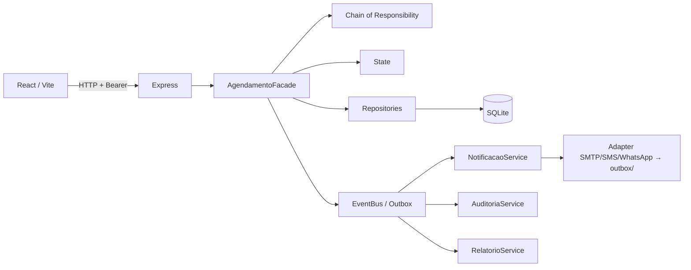

# MediAgenda

Sistema de marcação e gestão de consultas médicas, desenvolvido no âmbito da unidade curricular
de Engenharia de Software do **ISPT**. A aplicação é um **monólito modular** com API REST em
**Node.js/Express**, frontend em **React/Vite** e base de dados **SQLite** através do módulo nativo
`node:sqlite` — sem Docker, sem ORM e sem dependências nativas.

O objectivo do projecto é demonstrar, num sistema funcional e não apenas em diagramas, a aplicação
de **padrões de arquitectura e de desenho** (EDA, State, Chain of Responsibility, Observer, Strategy,
Factory Method, Adapter, Façade, Command, Singleton, Repository, ISP) e dos princípios **SOLID** e
**DRY**.

> Documentação detalhada: [docs/ARQUITETURA.md](docs/ARQUITETURA.md) · [docs/API.md](docs/API.md) ·
> [docs/GUIA-DEFESA.md](docs/GUIA-DEFESA.md) · [DEPLOY.md](DEPLOY.md)

---

## 1. Arranque rápido

Requisito: **Node.js 24+** (o projecto usa `node:sqlite`).

```bash
npm install
npm run setup      # cria a base e carrega os dados de demonstração
npm run dev        # API :4000 + frontend :5173
```

Abrir <http://localhost:5173>.

**No VS Code:** abrir a pasta `D:\MediAgenda`, `Terminal → New Terminal` e correr os três comandos
acima. `npm run dev` arranca dois processos → API na **4000** e Vite na **5173**. Confirmar com
<http://localhost:4000/api/health>. Antes de uma apresentação, `npm run reset` recria os dados de
demonstração (16 médicos activos em 8 cidades e 2 contas pendentes).

O guia completo de arranque, padrões com código, guião de demonstração e perguntas prováveis está em
**[docs/GUIA-DEFESA.md](docs/GUIA-DEFESA.md)**.

Produção (build do frontend servido pela própria API):

```bash
npm run build
npm start          # http://localhost:4000
```

### Contas de demonstração

| Perfil      | E-mail                       | Palavra-passe    |
| ----------- | ---------------------------- | ---------------- |
| Admin       | `admin@mediagenda.co.mz`     | `Admin@123`      |
| Secretária  | `secretaria@mediagenda.co.mz`| `Secretaria@123` |
| Médico      | `antonio@mediagenda.co.mz`   | `Medico@123`     |
| Paciente    | `maria@example.com`          | `Paciente@123`   |
| Médico pendente | `dr.pendente@mediagenda.co.mz` | `Medico@123` |
| Secretária pendente | `secretaria.pendente@mediagenda.co.mz` | `Secretaria@123` |

As duas contas **pendentes** existem para demonstrar o fluxo de aprovação: o login é recusado com
`APROVACAO_PENDENTE` até a secretária (médico) ou o administrador (secretária) autorizar.

Outros médicos: `joaquim@mediagenda.co.mz`, `ana.medica@mediagenda.co.mz`,
`lucia@mediagenda.co.mz` (todas com `Medico@123`). Outros pacientes: `carlos@example.com`,
`ana@example.com` (`Paciente@123`).

### Comandos

| Comando         | Efeito                                                             |
| --------------- | ------------------------------------------------------------------ |
| `npm run setup` | Instala, cria a base e faz seed se estiver vazia                    |
| `npm run dev`   | API com `--watch` + Vite com proxy `/api`                           |
| `npm run seed`  | Carrega dados apenas se a base estiver vazia                        |
| `npm run reset` | **Apaga** e recria todos os dados de demonstração                   |
| `npm test`      | Executa os testes (`node:test`) em base de dados temporária         |
| `npm run build` | Gera o build do frontend em `server/public`                          |
| `npm start`     | Arranca a API e serve o build                                      |

Variáveis de ambiente: `PORT` (4000), `MEDIAGENDA_DB` (caminho da base),
`MEDIAGENDA_SECRET` (segredo HMAC dos tokens), `MEDIAGENDA_OUTBOX` (pasta das notificações),
`MEDIAGENDA_URL` (URL usado nos links de e-mail; padrão `http://localhost:5173`) e
`SMTP_HOST`, `SMTP_PORT`, `SMTP_USER`, `SMTP_PASS`, `SMTP_FROM`, `SMTP_SECURE` (envio real).
Sem SMTP configurado, os e-mails ficam em `server/outbox/email`.

---

## 2. O que está implementado

### Requisitos funcionais

| ID    | Requisito                                                        | Onde ver na aplicação                                  |
| ----- | ---------------------------------------------------------------- | ------------------------------------------------------ |
| RF-01 | Registo e autenticação por perfil                                | `/registo`, `/login`, guardas de rota                  |
| RF-02 | Pesquisa de médicos por especialidade, nome, clínica e avaliação | página inicial e painel da secretária                  |
| RF-03 | Marcação de consultas com validação automática                   | detalhe do médico → escolher slot → marcar             |
| RF-04 | Disponibilidade semanal e bloqueios/férias do médico             | painel do médico → Disponibilidade                     |
| RF-05 | Confirmação, cancelamento e reagendamento                        | `AcoesConsulta` em todas as listas                     |
| RF-06 | Lembretes de 24h e 1h (scheduler + outbox)                       | Architecture Lab → Tick do scheduler                   |
| RF-07 | Gestão de pacientes pela secretária                              | painel da secretária → Pacientes                       |
| RF-08 | Painel do médico com agenda, pacientes e relatório               | `/medico`                                              |
| RF-09 | Painel administrativo com KPIs e relatórios                      | `/admin`                                               |
| RF-10 | Exportação de relatórios para Excel (CSV) e PDF (impressão)      | `/admin` → Relatórios → Excel (CSV) / PDF (Imprimir)   |
| RF-11 | Notificações por e-mail/SMS/WhatsApp (SMTP real opcional)        | `/notificacoes` e `server/outbox/`                     |
| RF-12 | Avaliação de consultas realizadas (1→5)                          | consulta realizada → Avaliar                           |
| RF-13 | Auditoria de operações críticas                                  | `/auditoria` (admin)                                   |
| RF-14 | Configuração da clínica pelo administrador                       | `/admin` → Configuração                                |

### Regras de negócio

| ID    | Regra                                                                 | Implementação                                        |
| ----- | --------------------------------------------------------------------- | ---------------------------------------------------- |
| RN-01 | Antecedência mínima de 1h                                             | `AntecedenciaMinima`                                 |
| RN-02 | Cancelamento abaixo de 24h é tardio e fica registado                  | `EstadoPendente/Confirmada.cancelar`                 |
| RN-03 | Limite diário de consultas por médico (padrão 10; Dr. António = 8 no seed) | `LimiteDiarioMedico`                                 |
| RN-04 | Duração da consulta definida pela especialidade/médico                | `EstrategiaDuracaoConsulta` (Strategy)               |
| RN-05 | Sem duas consultas simultâneas para o mesmo médico                    | `ConflitoAgenda`                                     |
| RN-06 | Máximo de 3 consultas futuras activas por paciente/médico             | `LimitePaciente`                                     |
| RN-07 | Confirmação em 2h; caso contrário a vaga é libertada                  | `EstadoPendente.confirmar` + scheduler               |
| RN-08 | Desactivar médico cancela consultas futuras e notifica                | `MedicoService.desactivar`                           |
| RN-09 | Horário da clínica, disponibilidade e bloqueios                       | `HorarioFuncionamento`                               |

A cadeia executa sempre pela ordem **RN-01 → RN-09 → RN-05 → RN-03 → RN-06** e pára no primeiro elo
que recusar. Cada execução é persistida em `validacoes_traces` e visível no **X-Ray** da consulta e no
**Architecture Lab**.

### Aprovação de contas (regras do trabalho)

| Cadastro | Quem aprova | Enquanto pendente |
| -------- | ----------- | ----------------- |
| Paciente | — (activo de imediato) | — |
| **Médico** | **Secretária** (ou admin) | login recusado com `APROVACAO_PENDENTE` |
| **Secretária** | **Administrador** | login recusado com `APROVACAO_PENDENTE` |

- Implementação: `AuthService.registar/aprovar/recusar/login` e `server/src/api/routes/secretaria.js`.
- O formulário público cria a conta com `estado_aprovacao = 'pendente'` e `ativo = 0`.
- Médicos/secretárias criados directamente pela secretária ou pelo admin ficam logo aprovados.
- O servidor recusa que a secretária aprove outras secretárias (403), mesmo por chamada directa à API.
- A decisão notifica o interessado e fica registada em auditoria (`CONTA_APROVADA` / `CONTA_RECUSADA`).

### Permissões operacionais

| Operação | Paciente | Médico | Secretária | Admin |
| -------- | :------: | :----: | :--------: | :---: |
| Confirmar a marcação | ✅ | ✅ | ✅ | ❌ |
| Marcar como realizada | ❌ | ✅ (só a sua) | ✅ | ❌ |
| Cancelar / reagendar | ✅ (só a sua) | ✅ (só a sua) | ✅ | ❌ |
| Aprovar médicos | ❌ | ❌ | ✅ | ✅ |
| Aprovar secretárias | ❌ | ❌ | ❌ | ✅ |
| Relatórios, configuração, auditoria | ❌ | ❌ | ❌ | ✅ |

### Requisitos não funcionais

- **RNF-01 Desempenho** — índices em `(medico_id, data_hora)`, `(paciente_id, data_hora)` e `estado`;
  respostas locais abaixo de 50 ms nos fluxos testados.
- **RNF-02 Segurança** — scrypt para palavras-passe, token HMAC-SHA256 assinado, RBAC por perfil,
  rate limiting e auditoria.
- **RNF-03 Usabilidade** — interface responsiva, modo claro/escuro, mensagens de erro explicativas e
  estados vazios.
- **RNF-04 Manutenibilidade** — camadas com dependências unidireccionais, padrões identificáveis por
  ficheiro e testes automatizados.
- **RNF-05 Portabilidade** — Node.js 24 e SQLite embutido; um único processo serve API e frontend.
- **RNF-06 Fiabilidade** — transacções SQLite, outbox de eventos e scheduler idempotente.
- **RNF-07 Observabilidade** — auditoria, consumos de eventos, traces de validação e logs do scheduler.

---

## 3. Padrões e onde estão

| Padrão                          | Ficheiro principal                              | Como é demonstrado                                                        |
| ------------------------------- | ----------------------------------------------- | ------------------------------------------------------------------------- |
| **Event-Driven + Observer**     | `server/src/events/EventBus.js`                 | Evento gravado no outbox e distribuído a 3 observadores independentes      |
| **State**                       | `server/src/domain/consulta/estados.js`         | Cada estado decide as transições válidas; não há `if (estado === ...)`     |
| **Chain of Responsibility**     | `server/src/domain/validacao/cadeia.js`         | 5 validadores encadeados, cada um com uma responsabilidade                 |
| **Strategy**                    | `server/src/domain/notificacao/estrategias.js`  | Canal de notificação (email/SMS/whatsapp/ambos) e duração da consulta      |
| **Factory Method**              | `server/src/domain/notificacao/factory.js`      | `NotificacaoFactory.criar('email' \| 'sms' \| 'whatsapp')`                 |
| **Adapter**                     | `server/src/domain/notificacao/canais.js`       | `AdapterSMTP` (nodemailer real) / `AdapterSMS` / `AdapterWhatsApp` isolam fornecedores externos |
| **Façade**                      | `server/src/services/AgendamentoFacade.js`      | Marcar/cancelar/reagendar/simular numa única entrada                       |
| **Command**                     | `server/src/commands/consultaCommands.js`       | Cancelar/reagendar como objectos auditáveis                               |
| **Singleton**                   | `server/src/config/ConfiguracaoSistema.js`      | Uma única configuração partilhada por todos os serviços                    |
| **Repository**                  | `server/src/repositories/*.js`                  | Acesso a dados encapsulado, sem SQL nos serviços                          |
| **ISP**                         | `server/src/domain/notificacao/canais.js`       | `IEnviadorEmail`, `IEnviadorSMS` e `IEnviadorWhatsApp` são contratos pequenos; o WhatsApp foi acrescentado sem alterar nenhum serviço |
| **SOLID / DRY**                 | todo o servidor                                 | Responsabilidades isoladas, injecção de dependências e utilitários comuns  |

O **Architecture Lab** (`/arquitetura`, apenas admin) mostra estes padrões, inclui a comparação
**"Sem padrões vs. Com padrões"**, executa a cadeia real em modo simulação (com o caso RN-03 pronto
a um clique), e apresenta o **Event Monitor** (eventos, consumidores e outbox) e o **Trace & Outbox**.

### Extensibilidade demonstrada — canal WhatsApp
O terceiro canal de notificação (`AdapterWhatsApp`, simulado em `outbox/whatsapp/`) foi acrescentado
**sem alterar nenhum serviço existente**: basta a nova interface (ISP), o adapter e o registo no
Factory/Strategy. O utilizador escolhe o canal em **Perfil → Notificações**; sem telefone, o sistema
retrocede para o e-mail automaticamente.

### E-mail real
`AdapterSMTP` usa **nodemailer** quando `SMTP_HOST`, `SMTP_USER` e `SMTP_PASS` estão definidos; envia
pela rede e guarda sempre uma cópia em `server/outbox/email`. Sem configuração, o comportamento é o
modo demonstração. Os links de confirmação (conta e consulta) usam `MEDIAGENDA_URL`.

---

## 4. Arquitectura em 30 segundos



- O frontend **só conhece a Façade**; nunca executa regras de negócio.
- As validações vivem na cadeia; as transições vivem no State; a persistência vive nos repositórios.
- Os efeitos secundários (notificar, auditar, invalidar relatórios) são observadores do evento.
- O evento é gravado antes de ser distribuído (**outbox**) e cada consumo é registado para inspecção.

---

## 5. Fluxo de uma marcação

1. O paciente escolhe médico, especialidade, data e hora.
2. `POST /api/consultas` chega à `AgendamentoFacade.marcar`.
3. A **Strategy** calcula a duração (especialidade vs. médico).
4. A **Chain** valida RN-01, RN-09, RN-05, RN-03 e RN-06, produzindo um trace com tempos por elo.
5. Se aprovado, a consulta é criada como `pendente`, com prazo de confirmação de 2h e um
   **token de confirmação** para o link enviado por e-mail.
6. A Façade publica `ConsultaCriada` no **EventBus**.
7. Os observadores notificam paciente e médico (com o link de confirmação), invalidam a cache de
   relatórios e registam auditoria.
8. O paciente confirma pelo link (token de uso único) ou o scheduler expira e liberta a vaga.

---

## 6. Testes

```bash
npm test
```

52 testes com `node:test`, executados em bases de dados temporárias (não tocam nos dados de demo):

- **Estados** — transições válidas/inválidas, RN-02 (tardio) e RN-07 (prazo).
- **Regras** — RN-01, RN-03, RN-05, RN-06, RN-09 (horário e bloqueio), permissões e scheduler.
- **Façade e EDA** — criação, evento, 3 consumidores, notificação, auditoria e confirmação.
- **Segurança** — scrypt, tokens assinados, adulteração e expiração.
- **API** — health, login, 401/403, registo/confirmação, notificações, demo, CSV e 404.

Resultado esperado: `pass 52 · fail 0`.

---

## 7. Guião de demonstração (5 minutos)

O guião completo, com tempos, credenciais e alternância de perfis, está em
**[docs/GUIA-DEFESA.md § 8](docs/GUIA-DEFESA.md)**. Sequência resumida:

1. **Registo de médico** → fica pendente; login recusado.
2. **Secretária** aprova o médico em `/secretaria` → **Médicos & aprovações**.
3. **Admin** aprova a secretária pendente em `/admin` → **Aprovações**.
4. **Admin** tenta cancelar/realizar uma consulta → os botões não existem e a API devolve 403.
5. **Paciente** (`maria@example.com`): marcar consulta, ver a cadeia de validação e confirmar pelo
   link do e-mail (ou por `confirmar-consulta?id=6&token=demo-consulta-pendente`).
6. **Médico** (`antonio@mediagenda.co.mz`) marca uma consulta confirmada como **realizada**.
7. **Architecture Lab**: simulador → **Preparar caso RN-03** → executar; ver Event Monitor e trace.
8. **Auditoria** e **Relatórios** (CSV/PDF); alternar modo escuro e testar responsividade.

---

## 8. Estrutura do projecto

```
server/src/api            rotas Express + middleware (auth, RBAC, erros, rate limit)
server/src/commands       Command pattern (cancelar/reagendar)
server/src/config         Singleton de configuração
server/src/db             schema.sql, seed e ligação SQLite
server/src/domain         State, Chain, Strategy, Factory, Adapter e canais
server/src/events         EventBus (EDA/Observer + outbox)
server/src/repositories   Repository pattern
server/src/services       casos de uso e Façade
server/src/utils          tempo, segurança e erros
server/tests              testes com node:test
web/src/pages             páginas por perfil + Architecture Lab + Auditoria
web/src/components        Layout, UI, acções de consulta
web/src/styles.css        design system, modo escuro e responsividade
docs                      arquitectura, referência da API e guia de defesa
scripts/setup.js          instalação inicial
```

---

## 9. Decisões e limitações

- **SQLite (`node:sqlite`)** em vez de MySQL/PostgreSQL: zero configuração, adequado a demonstração
  local e deploy num único processo. A camada de repositórios isola a migração futura.
- **Autenticação própria** (scrypt + HMAC) em vez de JWT/bcrypt: menos dependências e demonstração
  explícita do mecanismo.
- **Notificações**: SMTP real via `nodemailer` quando configurado; SMS e WhatsApp continuam simulados
  em `server/outbox/`. Trocar por um fornecedor real implica apenas substituir o Adapter.
- **Aprovação de contas**: médicos dependem da secretária e secretárias do administrador; enquanto
  pendentes, as credenciais não entram em vigor.
- **Administrador é de leitura operacional**: relatórios, configuração e aprovações; confirmar,
  cancelar ou reagendar é competência do paciente, do médico e da secretária.
- **Quatro estados**: `pendente`, `confirmada`, `realizada`, `cancelada`. “Não compareceu”, lista de
  espera, PWA e multi-clínica ficam no roadmap.
- **Cancelamento tardio é permitido** (RN-02): fica marcado em `cancelamento_tardio` e incrementa o
  contador do paciente; não é bloqueado.
- **Sem Tailwind/Framer/Recharts**: CSS próprio, SVG e animações CSS para manter o build leve.

### Roadmap

- Notificações reais (SMTP/SMS) e templates configuráveis.
- Estado “não compareceu” e lista de espera automática.
- Multi-clínica e multi-fuso horário.
- Aplicação móvel/PWA com notificações push.
- Migração opcional para PostgreSQL e testes de carga.

---

## 10. Deploy

O guia para Render (incluindo limitações do plano gratuito e persistência do SQLite) está em
[DEPLOY.md](DEPLOY.md).

