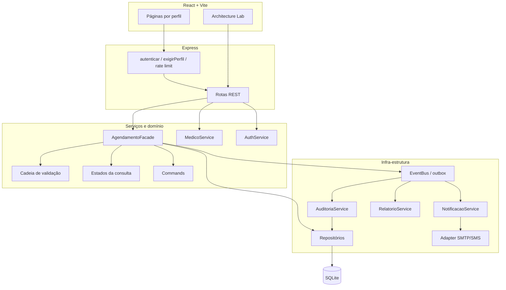
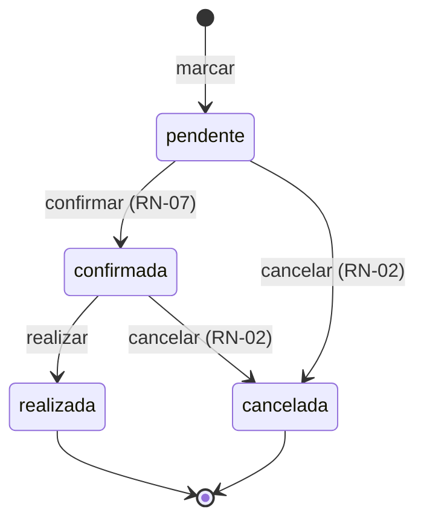
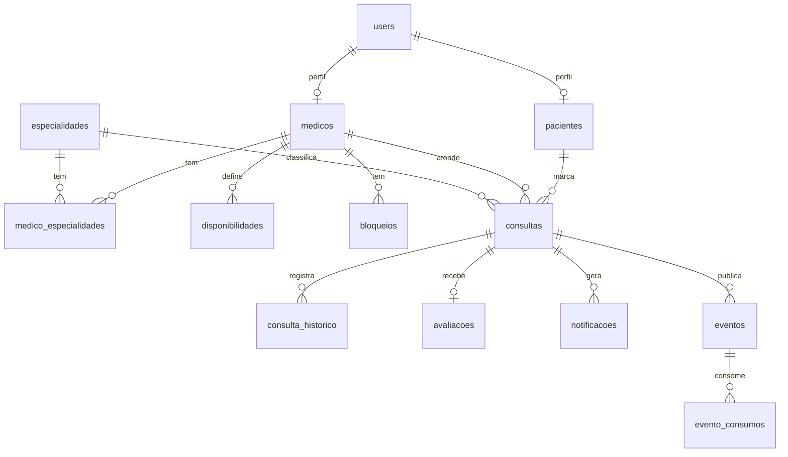

# Arquitectura do MediAgenda

Este documento descreve as decisões estruturais, os padrões aplicados, o modelo de dados e os
mecanismos transversais (autenticação, eventos, scheduler e observabilidade). O código é a fonte de
verdade; aqui explica-se **porque** está organizado assim.

---

## 1. Visão geral

O MediAgenda é um **monólito modular**: um único processo Node.js serve a API Express e, em produção,
os ficheiros estáticos do build React. A modularidade é interna e segue uma regra de dependência
unidireccional:

```
API (rotas) → Serviços/Façade → Domínio → Repositórios → SQLite
                     ↘ EventBus → Observadores (notificação, auditoria, relatórios)
```

| Camada          | Responsabilidade                                                        |
| --------------- | ----------------------------------------------------------------------- |
| `api`           | HTTP, validação de entrada, autenticação, RBAC e tradução de erros       |
| `services`      | Casos de uso e orquestração; a Façade é a porta de entrada               |
| `domain`        | Regras de negócio puras: estados, cadeia, estratégias, fábrica e canais  |
| `repositories`  | SQL e mapeamento de linhas; nenhuma regra de negócio                     |
| `events`        | Outbox e distribuição de eventos para observadores                       |
| `commands`      | Operações críticas auditáveis (cancelar/reagendar)                       |
| `config`        | Configuração Singleton da clínica                                        |

As rotas **não** contêm regras: chamam serviços. Os serviços **não** contêm SQL: chamam repositórios.
O domínio **não** conhece Express nem SQLite.

### Diagrama de componentes



---

## 2. Padrões aplicados

### 2.1 Event-Driven Architecture + Observer

`server/src/events/EventBus.js` é o **Subject**. Os observadores são registados no arranque
(`server/src/container.js`) para os oito tipos de evento de consulta.

```js
for (const tipo of EVENTOS_CONSULTA) {
  eventBus.subscrever(tipo, 'NotificacaoService', async (evento) => {
    await notificacaoService.aoEvento(evento.tipo, evento.payload.consulta);
  });
  eventBus.subscrever(tipo, 'RelatorioService', async () => {
    relatorioService.invalidarCache();
  });
  eventBus.subscrever(tipo, 'AuditoriaService', async (evento) => {
    auditoriaService.registar({ /* … */ });
  });
}
```

O produtor não conhece os consumidores. O evento é primeiro inserido na tabela `eventos` (outbox) e
só depois distribuído; cada consumo é registado em `evento_consumos` com estado `sucesso` ou `erro`.
É isso que alimenta o **Event Monitor** e o **Trace & Outbox** do Architecture Lab.

**Tipos de evento:** `ConsultaCriada`, `ConsultaConfirmada`, `ConsultaCancelada`, `ConsultaReagendada`,
`ConsultaExpirada`, `ConsultaRealizada`, `Lembrete24h`, `Lembrete1h`.

### 2.2 State

`server/src/domain/consulta/estados.js` implementa cada estado como uma classe. As transições válidas
são decididas pelo próprio estado, não por condicionais no serviço.



- `EstadoPendente.confirmar` verifica o prazo de 2 horas (RN-07).
- `EstadoPendente/Confirmada.cancelar` calcula se o cancelamento é tardio (RN-02).
- `EstadoRealizada` e `EstadoCancelada` recusam qualquer transição.
- `criarEstado(nome)` é a única fábrica usada pelos serviços e pela API.

### 2.3 Chain of Responsibility

`server/src/domain/validacao/cadeia.js` contém cinco elos independentes. Cada elo devolve
`{ ok, mensagem, detalhe }` e mede a sua duração. A cadeia pára no primeiro `ok: false` e devolve os
passos executados, o que permite explicar a recusa ao utilizador.

| Ordem | Elo                                  | Regra  |
| ----- | ------------------------------------ | ------ |
| 1     | Antecedência mínima                  | RN-01  |
| 2     | Horário de funcionamento/disponibilidade | RN-09 |
| 3     | Conflito de agenda                   | RN-05  |
| 4     | Limite diário do médico              | RN-03  |
| 5     | Limite de consultas do paciente      | RN-06  |

O trace é persistido em `validacoes_traces` com `passos`, `pedido`, `rejeitado` e `tipo`
(`marcacao`, `simulacao`, `reagendamento`). O endpoint `GET /api/consultas/:id/xray` devolve-o.

### 2.4 Strategy

Duas estratégias independentes:

- **Notificação** (`estrategias.js`): `email`, `sms` ou `ambos`, escolhida pela preferência do
  utilizador; o canal sem contacto é removido em tempo de execução.
- **Duração** (`EstrategiaDuracaoConsulta`): usa a duração da especialidade quando definida, senão a
  duração do médico, limitada entre 60 e 120 minutos (RN-04).

### 2.5 Factory Method + Adapter + ISP

`NotificacaoFactory.criar('email' | 'sms')` devolve `EmailNotificacao` ou `SMSNotificacao`, validando
que o adapter recebido cumpre a interface correcta. Os adapters `AdapterSMTP` e `AdapterSMS`
implementam apenas o seu contrato pequeno (`IEnviadorEmail`/`IEnviadorSMS`), respeitando o
**Interface Segregation Principle**. Em vez de enviar pela rede, escrevem ficheiros em
`server/outbox/email` e `server/outbox/sms` (configurável por `MEDIAGENDA_OUTBOX`).

### 2.6 Façade

`AgendamentoFacade` expõe quatro operações: `marcar`, `cancelar`, `reagendar` e `simular`. Cada uma
coordena validação, persistência, evento, auditoria e trace. O frontend nunca chama a cadeia, o State
ou os repositórios directamente.

### 2.7 Command

`CancelarConsultaCommand` e `ReagendarConsultaCommand` encapsulam operações críticas. Cada comando
verifica permissões, aplica o State, publica o evento e regista auditoria com `comando`, `motivo`,
`tardio`, `estadoAnterior` e `descricao()`. O **administrador é bloqueado aqui**, no servidor, antes
de qualquer alteração de estado; a interface apenas reflecte essa regra.

### 2.8 Singleton

`ConfiguracaoSistema` mantém uma instância única e uma cache de valores. Todos os serviços recebem a
mesma instância; alterações no painel admin invalidam apenas a chave modificada.

### 2.9 Repository

Cada agregado tem o seu repositório. Os repositórios devolvem objectos já enriquecidos (por exemplo,
`ConsultaRepository.porId` junta paciente, médico, especialidade e avaliação) para evitar N+1 nos
serviços. Nenhum serviço escreve SQL.

---

## 3. Modelo de dados



| Tabela                | Conteúdo                                                                |
| --------------------- | ----------------------------------------------------------------------- |
| `users`               | Credenciais, perfil, estado de aprovação, preferência de notificação e controlo de bloqueio |
| `pacientes`/`medicos` | Dados específicos do perfil, incluindo contador de cancelamentos tardios |
| `especialidades`      | Duração padrão e estado activo                                          |
| `disponibilidades`    | Janelas semanais por médico (1 = segunda … 5 = sexta)                    |
| `bloqueios`           | Férias/formações com intervalo e motivo                                  |
| `consultas`           | Data/hora, duração, estado, prazo e token de confirmação, flags de cancelamento |
| `consulta_historico`  | Timeline de transições com autor e motivo                               |
| `avaliacoes`          | Pontuação 1–5 e comentário (uma por consulta)                           |
| `notificacoes`        | Mensagens por canal, evento e estado de leitura                         |
| `auditoria`           | Quem, quando, o quê, entidade, IP e detalhes                            |
| `eventos`             | Outbox com payload e data de processamento                              |
| `evento_consumos`     | Resultado de cada observador por evento                                 |
| `validacoes_traces`   | Passos da cadeia, tempos e resultado                                    |
| `configuracoes`       | Chave/valor com descrição e padrão                                      |

Índices relevantes: `idx_consultas_medico_data`, `idx_consultas_paciente`,
`idx_consultas_estado`. As datas são guardadas em **ISO UTC**; a interface formata em hora local
(África/Maputo, UTC+2).

---

## 4. Autenticação, autorização e segurança

1. O registo valida e-mail, palavra-passe (mínimo 6) e perfil permitido; cria o utilizador e o perfil
   específico numa sequência controlada.
2. **Aprovação de contas** — o cadastro só entra em vigor depois da entidade competente confirmar:

   | Cadastro | Quem aprova | Enquanto pendente |
   | --- | --- | --- |
   | Paciente | — | activo de imediato |
   | Médico | **Secretária** (o admin também pode) | `estado_aprovacao='pendente'`, `ativo=0`, login recusado |
   | Secretária | **Administrador** | `estado_aprovacao='pendente'`, `ativo=0`, login recusado |

   O login valida primeiro a palavra-passe e só depois revela o estado, devolvendo
   `403 APROVACAO_PENDENTE` ou `APROVACAO_RECUSADA`. A secretária **não** aprova secretárias: a
   verificação está no servidor (`AuthService.#garantirPoderDeAprovacao`), não apenas na interface.
   Cada decisão notifica o interessado e fica em auditoria (`CONTA_APROVADA` / `CONTA_RECUSADA`).
3. A palavra-passe é guardada como `salt:hash` usando **scrypt** (64 bytes, salt aleatório de 16).
4. O login compara com `timingSafeEqual`, incrementa tentativas falhadas e bloqueia a conta durante
   15 minutos ao fim de 5 tentativas.
5. O token é `base64url(payload).HMAC-SHA256(payload)`, com validade de 7 dias. O payload contém
   `sub`, `nome`, `perfil`, `medicoId` e `pacienteId`.
6. O middleware `autenticar` valida a assinatura e expiração; `exigirPerfil` aplica o RBAC.
7. Cada pedido passa por um rate limit em memória (300 pedidos/minuto por IP).
8. Operações críticas registam auditoria; erros de negócio devolvem `{ erro, codigo, detalhes }`.

| Recurso                                | Público | Paciente | Médico | Secretária | Admin |
| -------------------------------------- | :-----: | :------: | :----: | :--------: | :---: |
| Catálogo de médicos/horários           |    ✓    |    ✓     |   ✓    |     ✓      |   ✓   |
| Marcar consulta                        |         |    ✓     |   ✓    |     ✓      |   ✓   |
| Ver consultas                          |         | as suas  | as suas |    todas   | todas |
| Confirmar consulta                     |         |    ✓     |   ✓    |     ✓      |   —   |
| Marcar como realizada                  |         |    —     | a sua  |     ✓      |   —   |
| Cancelar / reagendar                   |         | as suas  | as suas |     ✓      |   —   |
| Gerir agenda e disponibilidade         |         |          |   ✓    |            |   —   |
| Pacientes (gestão)                     |         |          |        |     ✓      |   ✓   |
| Aprovar médicos                        |         |          |        |     ✓      |   ✓   |
| Aprovar secretárias                    |         |          |        |     —      |   ✓   |
| Relatórios, config., utilizadores      |         |          |        |            |   ✓   |
| Audit., eventos, Architecture Lab      |         |          |        |            |   ✓   |

Além do perfil, os serviços verificam a **propriedade** do recurso: um paciente só acede às suas
consultas, um médico só à sua agenda. O **administrador** vê e configura, mas não executa operações
operacionais — confirmar, realizar, cancelar e reagendar devolvem `403` mesmo por chamada directa à
API. A RN-08 é executada internamente com o perfil `sistema`.

---

## 5. Scheduler e lembretes

O scheduler corre 3 segundos após o arranque e depois a cada 60 segundos (`server/src/index.js`).
Também pode ser executado manualmente no Architecture Lab (`POST /api/demo/tick`).

- `expirarPendentes()`: procura consultas `pendente` com `prazo_confirmacao <= agora`, passa-as a
  `cancelada`, registra histórico e publica `ConsultaExpirada` (RN-07).
- `enviarLembretes()`: procura consultas confirmadas nas janelas de 23,5–24,5h e 0,5–1,5h, evita
  duplicados através das notificações já existentes e publica `Lembrete24h`/`Lembrete1h` (RF-06).

Ambas as operações são idempotentes: repetir um tick não duplica eventos nem notificações.

---

## 6. Observabilidade e “X-Ray”

- **Auditoria** — tabela `auditoria` com filtros por acção na página `/auditoria`.
- **Event Monitor** — `GET /api/admin/eventos` + `/api/demo/estado`; mostra eventos, consumidores,
  consumos por observador e a outbox de notificações.
- **Trace & Outbox** — `GET /api/consultas/:id/xray` mostra a timeline da consulta, os traces da
  cadeia e os eventos associados.
- **Relatórios** — `RelatorioService` mantém uma versão de cache; cada evento de consulta incrementa a
  versão, tornando visível a invalidação no painel admin.

---

## 7. Tratamento de erros

`ErroNegocio` e subclasses (`ErroValidacao`, `ErroNaoEncontrado`, `ErroProibido`, `ErroAutenticacao`)
transportam `status`, `codigo` e `detalhes`. O middleware `tratarErros` traduz tudo para:

```json
{ "erro": "mensagem legível", "codigo": "VALIDACAO_FALHOU", "detalhes": { "passos": [], "traceId": 42 } }
```

As recusas da cadeia usam `422 VALIDACAO_FALHOU` e incluem os passos executados, permitindo ao
frontend mostrar exactamente qual regra falhou e porquê.

---

## 8. Decisões e trade-offs

| Decisão                              | Alternativa descartada        | Justificação                                              |
| ------------------------------------ | ----------------------------- | --------------------------------------------------------- |
| SQLite nativo                        | MySQL/PostgreSQL + Docker     | Zero configuração, deploy simples, suficiente para o âmbito |
| Token HMAC próprio                   | JWT/bcrypt                    | Menos dependências, mecanismo explícito e didáctico        |
| Outbox em SQLite                     | Fila externa (Kafka/Rabbit)   | Demonstra EDA sem infra-estrutura adicional                |
| CSS próprio                          | Tailwind/Framer/Recharts      | Controlo visual, build leve e sem dependências extra       |
| Quatro estados                       | Incluir “não compareceu”      | Mantém o State simples; fica no roadmap                    |
| Cancelamento tardio permitido        | Bloquear abaixo de 24h        | RN-02 pede registo, não impedimento                        |
| Aprovação em dois níveis             | Activação imediata            | Regra do trabalho: médico confirmado pela secretária; secretária pelo admin |

---

## 9. Como estender

- **Novo canal de notificação**: criar um adapter que implemente `IEnviadorEmail`/`IEnviadorSMS`,
  registá-lo na Factory e adicionar a estratégia.
- **Nova regra de negócio**: criar um `Validador`, encadeá-lo em `CadeiaValidacao` e adicionar o teste.
- **Novo estado**: criar a classe, registá-la em `criarEstado`, actualizar o `CHECK` do schema e o
  diagrama do Architecture Lab.
- **Novo consumidor de eventos**: subscrever no `container.js`; o produtor não muda.
- **PostgreSQL**: substituir a implementação dos repositórios e a ligação em `server/src/db/index.js`.
